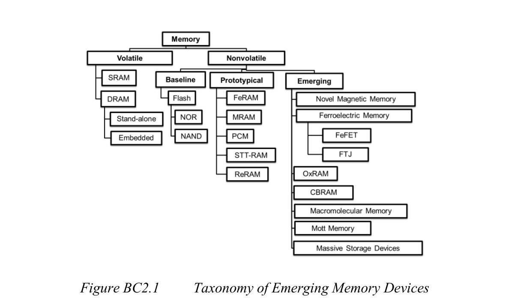

# IRDS 2024新型非易失存储技术调研

## 1. IRDS 2024怎样分类新型存储

IRDS首先将存储器分为易失性和非易失性两类，再按技术成熟度把非易失性存储分为三层：

1. **Baseline（基准技术）**：Flash，包括NOR和NAND。它是其他非易失存储器比较性能、成本和成熟度的基准。
2. **Prototypical（原型或准成熟技术）**：FeRAM、MRAM、PCM、STT-RAM和ReRAM。这些技术已经形成较完整的器件、工艺和系统知识，其中一部分已有产品，但通常只占据特定市场。
3. **Emerging（新兴研究技术）**：Novel Magnetic Memory、Ferroelectric Memory（FeFET、FTJ）、OxRAM、CBRAM、Macromolecular Memory、Mott Memory和Massive Storage Devices。这些技术已显示潜在优势，但仍存在影响大规模商业化的基础科学或制造障碍。

### 1.1 成熟度分级方法

本文采用五级成熟度，避免把“做出单器件”“完成阵列流片”和“形成量产产品”混为一谈。

| 等级             | 含义                                               |
| ---------------- | -------------------------------------------------- |
| M5：规模商用     | 有稳定供应链、标准产品和批量客户                   |
| M4：特定市场商用 | 已有产品或量产工艺，但容量、成本或市场范围有限     |
| M3：工程验证     | 已有较大阵列、代工平台或客户原型，尚未形成广泛市场 |
| M2：实验阵列     | 已从单器件进入小型或中型阵列研究                   |
| M1：基础研究     | 主要是材料、单器件或概念验证                       |

成熟度是动态判断，不是IEEE认证等级。

## 2. 新型非易失存储技术族群

### 2.1 铁电存储

#### 2.1.1 铁电存储的基本原理

铁电存储利用铁电材料在撤去外加电场后仍能保持的剩余极化状态保存信息。写入时，正向或反向电场驱动铁电畴翻转；读取时，根据极化电荷、晶体管阈值电压或隧穿电阻的差异判断数据。该族群的共同基础是“可翻转且非易失的电极化”，但不同器件采用不同读出方式：FeRAM直接感测铁电电容的极化，FeFET利用极化引起的阈值电压偏移，FTJ则利用极化对量子隧穿电流的调制。

#### 2.1.2 已商业化的铁电存储

在IRDS Figure BC2.1中，FeRAM被单列于Prototypical层，主要指已经实现产品化的电容型铁电RAM。它与Emerging层的FeFET、FTJ共享铁电极化这一物理基础，但单元结构、读出方式和产业成熟度不同。

##### 2.1.2.1 FeRAM：电容型铁电随机存储器

###### 工作原理

FeRAM利用铁电材料在零电场下仍能保持的两种剩余极化方向表示0和1。传统单元通常为1T1C：一个访问晶体管连接一个铁电电容。写入时，正负电压使铁电畴朝相反方向排列；读取时，将铁电电容与参考单元比较，通过是否发生极化翻转判断原状态。

传统材料包括PZT、SBT等钙钛矿铁电体，近年来也研究HfO₂/HfZrO₂基铁电电容。

###### 优点

- 写入速度快，不需要Flash的毫秒级擦除或编程过程；
- 写入电压和能量较低；
- 擦写寿命很高，现有商业器件公开指标可达到约10¹⁴次写入周期；
- 不需要块擦除和复杂磨损均衡；
- 对辐射引起的电荷扰动相对不敏感；
- 适合频繁写入和掉电时即时保存。

###### 缺点

- 传统FeRAM读取具有破坏性，读出后必须恢复写入；
- 铁电电容的感测信号随面积缩小而下降；
- PZT等材料和电极给先进CMOS工艺带来污染、温度预算和集成困难；
- 1T1C单元及参考、感测电路限制密度；
- 商业容量通常处于Kb—Mb级，单位比特成本明显高于Flash。

###### 应用场景

- 电表、工业控制器和机器人运行日志；
- 汽车事件数据记录、BMS和ECU状态保存；
- 医疗设备、可穿戴设备和低功耗传感器；
- RFID、智能卡和安全计数器；
- 航天、高可靠和抗辐射小容量存储。

###### 当前成熟度

**M4：特定市场商用。** Infineon等厂商持续供应独立F-RAM产品，说明FeRAM不是实验室概念；但容量和成本使其主要停留在高耐久、小容量市场，尚不能与NOR或NAND竞争大容量代码和数据存储。

#### 2.1.3 新型铁电存储

本组对应IRDS Figure BC2.1中Emerging层的Ferroelectric Memory。IRDS正文重点讨论FeFET和FTJ：前者把极化状态转换为晶体管阈值电压差，后者把极化状态转换为隧穿电阻差。

##### 2.1.3.1 FeFET：铁电场效应晶体管

**原理：** 在MOSFET栅叠层中加入铁电层。铁电极化朝向不同方向时，沟道阈值电压发生非易失偏移；在两个阈值之间选择读取电压即可区分状态。常见结构包括MFS、MFIS和MFMIS，现代研究重点是掺杂HfO₂或HfZrO₂铁电层。

**优点：**

- 单晶体管1T单元，密度潜力高；
- 读取非破坏，栅极读取电流低；
- HfO₂材料体系与先进高κ金属栅CMOS较兼容；
- 支持多阈值和模拟权重；
- 可构建NOR型阵列或类似NAND串的FeNAND。

**缺点：**

- 界面电荷俘获会改变或掩盖极化窗口；
- 去极化场影响长期保持；
- wake-up、疲劳、imprint和晶粒差异造成漂移与波动；
- 耐久与保持之间存在显著权衡：超薄界面层利于保持但易因俘获退化，提高耐久的工作方式又可能牺牲保持；
- 纳米尺寸接近铁电晶粒/畴尺寸时，统计波动加剧。

**应用场景：** 嵌入式Flash替代、低功耗MCU、非易失逻辑、存内计算、多值突触、潜在FeNAND高密度存储。

**当前成熟度：M2—M3。** IRDS记录了28 nm平台64 Kb和22 nm FD-SOI平台32 Mb阵列演示，说明已超出单器件阶段；但大规模产品的保持、耐久和分布数据仍不充分。

##### 2.1.3.2 FTJ：铁电隧穿结

**原理：** 在两个电极之间放置极薄铁电势垒。极化反向会改变隧穿势垒高度、宽度或电极界面耗尽区，从而形成高低电阻状态，称为隧穿电致电阻效应（TER）。

**优点：**

- 两端结构，理论单元面积小；
- 读取非破坏；
- 写入主要翻转极化，能耗潜力很低；
- 理论上兼具长保持、高耐久和多值能力；
- 电导可用于模拟突触和存内计算。

**缺点：**

- 势垒越薄越利于读电流，却越难保持稳定铁电极化；
- 常规TER约10—100，读出裕量仍需提高；
- 读电流较小，缩小尺寸后感测更加困难；
- 无自整流时仍需选择器抑制潜通路；
- 钙钛矿铁电体、电极和外延工艺难与大规模CMOS集成；
- 氧空位可能使实验器件同时表现出RRAM效应，机理需要严格区分。

**应用场景：** 超低功耗NVM、多值存储、模拟突触、高密度交叉阵列。

**当前成熟度：M1—M2。** 主要是单器件和小阵列，IRDS认为尚不能对大阵列状态分布、保持和MLC能力作出充分结论。

### 2.2 磁性存储

磁性存储利用磁性材料中能够稳定保持的磁化方向或磁结构表示信息。其典型存储单元是磁隧道结：参考磁层的方向固定，自由磁层的方向可以改变；两层磁化方向平行或反平行时，器件呈现不同隧穿电阻，读取电路据此区分0和1。各类MRAM的主要差别不在读取机理，而在于如何翻转自由磁层，例如使用磁场、自旋转移力矩、自旋轨道力矩或电压控制磁各向异性。

在Figure BC2.1中，IRDS把MRAM和STT-RAM列入Prototypical，并在Emerging下设置Novel Magnetic Memory总类；分类图本身没有列出SOT和VCMA。随后第2.2.1节正文从写入机制角度讨论STT、SOT和VCMA，其中STT已经进入商业生产，而SOT和VCMA主要面向更低写能耗、更高耐久和缓存级速度。下文据此将磁性存储整理为“共性原理—已商业化路线—新型磁性路线”三个层次。

#### 2.2.1 磁隧道结与MRAM基本原理

##### 工作原理

MRAM的核心是磁隧道结（MTJ），通常由参考磁层、MgO隧穿势垒和自由磁层构成。当自由层与参考层磁化方向平行时，MTJ处于低电阻状态；反平行时处于高电阻状态。读取电路通过隧穿磁阻差判断数据。

“MRAM”是技术家族，常见分支包括早期场写入/Toggle MRAM、STT-MRAM、SOT-MRAM和VCMA-MRAM。IRDS在Prototypical栏中的MRAM主要涵盖已经形成产品的场写入和磁阻存储器产品。

#### 2.2.2 已进入原型或商业阶段的MRAM

**总体成熟度为M4：特定市场商用。** Toggle MRAM和STT-MRAM均有独立产品；三星、GlobalFoundries等也已公布嵌入式MRAM工艺。它是当前产业成熟度最高的新型非易失存储家族之一，但尚不是主流大容量存储。

##### 2.2.2.1 场写入MRAM与Toggle MRAM

**工作原理：** 早期场写入MRAM利用字线和位线中的电流产生磁场，直接翻转自由磁层。Toggle MRAM在此基础上使用具有合成反铁磁结构的自由层，并按特定时序施加两个方向的磁场脉冲，使磁化状态以“翻转”方式切换。

**优点：** 写入电流不穿过MgO隧穿势垒，器件耐久性高；产品和可靠性经验较成熟，适合工业、汽车、航空航天等高可靠场景。

**缺点：** 产生写磁场需要较大电流和额外写入线；单元缩小时所需翻转磁场不会同比降低，相邻单元还可能受到磁场干扰，因此密度、功耗和可缩放性不如STT-MRAM。

**应用场景与成熟度：** 主要用于容量要求不高但强调耐久、掉电保护和恶劣环境可靠性的独立存储器，属于已经商业化但不再承担先进节点高密度缩放任务的路线。

##### 2.2.2.2 STT-RAM／STT-MRAM：自旋转移力矩存储

###### 工作原理

写入电流穿过MTJ后被参考磁层极化，极化电子把角动量传递给自由层，使其磁化方向翻转。反向电流产生相反磁化方向。现代产品通常采用垂直磁各向异性MTJ，即p-STT-MRAM，以改善密度和开关电流。

###### 优点

- 典型1T1MTJ单元，结构比6T SRAM紧凑；
- 纳秒级读写潜力；
- 高耐久、非易失、低待机功耗；
- 后端增加的掩膜数量通常少于嵌入式Flash；
- 适合28 nm以下难以集成eFlash的逻辑节点。

###### 缺点

- 写入电流和读取电流均穿过MgO势垒，高速写入可能损伤势垒；
- 低错误率、短延迟和低写能量难以同时满足；
- 大写电流要求更大的访问晶体管，抵消单元面积优势；
- 小尺寸MTJ的热稳定性下降；
- 面向DRAM容量和成本目标仍缺少清晰路径。

###### 应用场景

- MCU和SoC嵌入式代码存储；
- IoT、汽车电子和边缘AI芯片；
- 片上末级缓存和非易失缓存；
- 数据中心持久缓冲、日志和元数据保护。

###### 当前成熟度

**M4，局部接近M5。** IRDS明确认为STT-MRAM已经进入嵌入式和独立产品的商业生产阶段。公开产品包含Mb级串行器件和Gb级、类似DDR接口的独立器件。不过在成本、容量和标准生态上仍未达到Flash、SRAM或DRAM的普及程度。

#### 2.2.3 新型磁性存储

本组对应Figure BC2.1中的Novel Magnetic Memory。SOT和VCMA并未直接画在分类图中，而是由IRDS第2.2.1节正文进一步展开；它们试图解决STT-MRAM在高速写入时的写电流、隧穿势垒可靠性和能耗问题。

##### 2.2.3.1 SOT-MRAM

**原理：** 电流沿具有强自旋轨道耦合的重金属、拓扑材料或反铁磁材料流动，经自旋霍尔效应或界面效应产生横向自旋流，作用于相邻自由磁层并翻转其磁化方向。读取仍通过MTJ完成。

**优点：**

- 读写通路分离，写电流不穿过MgO隧穿势垒；
- 有利于提高耐久度和读出电压；
- 已展示亚纳秒写入，适合高速缓存；
- 可以与VCMA联合降低写入能量。

**缺点：**

- 常见三端结构面积大于STT的1T1MTJ；
- 写入电流密度仍高；
- 垂直磁化的无外场确定性翻转较难；
- 自旋源材料、界面和工艺控制尚未成熟。

**应用场景：** SRAM替代型片上缓存、非易失寄存器、高耐久写密集型存储、存内逻辑。

**成熟度：M2—M3。** 已有晶圆和宏单元演示，仍以研发和试产为主，尚无与STT-MRAM相当的规模市场。

##### 2.2.3.2 VCMA-MRAM

**原理：** 在自由磁层/MgO界面施加电场，改变界面轨道占据和垂直磁各向异性，暂时降低两个稳定磁态之间的能垒；配合精确脉冲、STT或SOT完成翻转。

**优点：**

- 电压驱动，理论写入能耗可低至飞焦耳级；
- 写入后撤去电压，磁能垒恢复，可兼顾保持；
- 可作为STT/SOT的辅助机制降低写电流。

**缺点：**

- 现有材料的VCMA系数通常不足；
- 进动式翻转对脉冲宽度非常敏感；
- 确定性、写错误率和工艺波动是难点；
- 较厚隧穿势垒有利于电压控制，却会提高读取电阻。

**应用场景：** 超低能耗缓存、低功耗边缘计算、SOT/STT辅助写入。

**成熟度：M1—M2。** 以单器件和小阵列研究为主。

### 2.3 相变存储

相变存储利用材料在两种或多种结构相态之间发生可逆转变时产生的电阻、光学反射率或折射率差异保存信息。半导体PCM通常以硫系材料的低阻晶态和高阻非晶态表示数据：较强的短脉冲使材料熔化并快速淬火形成非晶态，较低且较长的脉冲使其重新结晶。读取时施加不会触发相变的小信号测量电阻。由于相变比例可以连续调节，该族群既能实现二值和多值存储，也能用于模拟权重和存内计算。

#### 2.3.1 PCM／PCRAM：相变随机存储器

##### 工作原理

PCM利用硫系相变材料不同结构状态的电阻差存储数据，典型材料为Ge₂Sb₂Te₅（GST）。

- **RESET**：短而强的脉冲使局部材料熔化并快速淬火，形成高阻非晶态；
- **SET**：幅度较低但时间较长的脉冲使材料退火结晶，形成低阻晶态；
- 通过控制脉冲可获得中间晶化比例，从而实现多值或模拟电导。

##### 优点

- 非易失、真正随机访问和位可改写；
- 写入前通常不需要像Flash那样先进行块擦除；
- 两端电阻结构适合交叉阵列和多层堆叠；
- 具有多值存储能力；
- 电导可渐进变化，适合模拟存内计算和神经形态权重。

##### 缺点

- RESET需要熔化材料，电流和热功耗较高；
- SET结晶速度慢于RESET，IRDS指出通常超过100 ns；
- 相邻单元存在热串扰风险；
- 非晶态电阻随时间漂移，影响多值读取精度；
- 材料与电极反应、元素迁移和热循环会限制寿命；
- 约250°C焊接回流条件下的预写数据保持是嵌入式应用挑战。

##### 应用场景

- 嵌入式NOR Flash替代候选；
- 存储级内存和低延迟持久存储；
- 多值存储；
- 模拟存内计算、神经网络推理和权重存储；
- 光电融合及非易失光子权重。

##### 当前成熟度

**M3—M4。** PCM曾形成量产产品，并用于部分功能手机等消费电子设备，但当前没有成为通用独立存储主流。3D XPoint曾以交叉点架构的存储级内存产品进入市场；Intel于2022年启动Optane存储业务的退出程序。由于厂商并未完整公开3D XPoint的材料体系和开关机理，本文不把它直接等同于传统GST型PCM。当前产业和研究重点更多转向嵌入式存储、材料改进和模拟AI芯片。IBM已经公开包含数千万PCM单元的模拟AI研究芯片，证明了系统级计算潜力，但这不等同于通用存储商业化。

### 2.4 阻变存储

阻变存储利用材料内部离子、缺陷或界面状态的可逆变化，在高阻态和低阻态之间保存信息。写入电压会驱动氧离子、氧空位或金属离子迁移，引起导电细丝的形成与断裂、界面势垒改变或存储层整体电阻变化；读取时使用较小电压测量电阻，避免扰动原状态。ReRAM是这一族群的宽泛名称，OxRAM主要依靠氧离子或氧空位运动，CBRAM则依靠Ag、Cu等金属离子形成和溶解导电桥。

IRDS Figure BC2.1按成熟度把ReRAM列入Prototypical层，同时把OxRAM和CBRAM列入Emerging层；这是路线图式的成熟度呈现，并不意味着三者是互斥的物理类别。从器件机理看，ReRAM是上位总称，OxRAM和CBRAM是其中两条主要实现路线。下文因此先说明ReRAM共性，再分述OxRAM和CBRAM。

#### 2.4.1 ReRAM的定义与共性原理

##### 工作原理

ReRAM通过外加电压可逆改变存储层电阻。其物理机制可能是氧空位导电细丝、金属导电桥、界面势垒、相态变化或其他离子/电子过程。因此“ReRAM”是宽泛家族名称，IRDS后文讨论的OxRAM和CBRAM均可视为其中的重要物理分支。

典型阵列单元为1T1R、1S1R或无源交叉点1R。读取时使用不改变状态的小电压检测高、低阻态。

##### 当前成熟度

**M3。** 小容量嵌入式阵列和工艺平台已多次公布。GlobalFoundries于2025年宣布22FDX+ RRAM可用于原型开发，说明产业正在由实验阵列进入工程导入；但大容量独立ReRAM尚未形成与NAND竞争的市场。

#### 2.4.2 OxRAM：氧化物阻变存储

OxRAM利用金属氧化物中氧离子或氧空位迁移以及氧化还原反应改变电阻。IRDS进一步分为三类。

##### 2.4.2.1 双极细丝型OxRAM

**原理：** 首次forming在HfOₓ、TaOₓ、TiOₓ、ZrOₓ等介质中产生富氧空位导电细丝；相反极性的SET和RESET脉冲分别修复或断开细丝薄弱位置。

**优点：**

- 存储节点可缩至数纳米；
- 已有亚纳秒开关和高耐久单器件演示；
- HfOₓ、TaOₓ与CMOS工艺兼容性较好；
- 适合后端集成、多层阵列和模拟权重。

**缺点：**

- 细丝具有随机性，电压和阻值分布宽；
- 成熟材料的写电流仍可能达到数十微安以上；
- 多值存储通常需要写入—验证闭环；
- 大规模阵列中的极少数异常位会主导良率和可靠性。

**应用场景：** 嵌入式NVM、安全存储、数字存内计算、模拟AI加速器。

**成熟度：M3。** OxRAM是ReRAM中最接近工程化的分支。

##### 2.4.2.2 双极非细丝型OxRAM

**原理：** 通过较大面积的氧空位重新分布、界面势垒或导电氧化物体电阻变化切换状态，代表材料包括PrCaMnO₃、Nb:SrTiO₃等钙钛矿氧化物。

**优点：**

- 状态由较大体积共同贡献，理论上可减小单根细丝引起的随机性；
- 适合多级、连续电导和模拟更新；
- 某些结构具有自整流或强非线性，可降低潜通路。

**缺点：**

- 存在“电压—时间困境”：快速低压写入与多年保持难以同时获得；
- 钙钛矿材料的原子层沉积、化学计量和结晶温度控制困难；
- 常需Pt等不利于先进生产线的电极；
- 工业兼容材料替代尚未完全解决。

**应用场景：** 模拟存内计算、自选择交叉阵列、多值存储。

**成熟度：M2。** 已有小型阵列，主要受材料集成和保持性能限制。

##### 2.4.2.3 单极细丝型OxRAM

**原理：** SET和RESET使用同一极性，局部焦耳热使导电细丝恢复或像保险丝一样熔断，属于热化学开关。

**优点：**

- 驱动极性和外围电路较简单；
- 可与二极管选择器配合；
- 高低阻比通常较大。

**缺点：**

- RESET电流和功耗较高；
- 热过程导致波动和耐久性问题；
- 综合性能通常不如双极型，因此研究重心已经转向双极OxRAM。

**应用场景：** 简化外围电路的交叉阵列、特定Contact-RRAM结构。

**成熟度：M2。** 有阵列和CMOS集成演示，但不是当前主流RRAM路线。

#### 2.4.3 CBRAM：导电桥随机存储器

##### 工作原理

CBRAM又称PMC、ECM、固体电解质开关或原子开关。器件由Ag、Cu或Ni等电化学活性电极、固体电解质和W、Ta、Ru、Pt等惰性电极组成。写入电压使活性金属氧化成离子，在电解质中迁移并于另一端还原，逐渐形成金属桥；反向电压使金属桥溶解。

##### 优点

- 低电压、低电流和低写入能量；
- 写入和擦除速度快；
- 两端结构适合交叉阵列；
- 具有约10 nm及以下缩放潜力；
- 可用于数字状态、多值状态和原子级可重构开关。

##### 缺点

- 金属离子迁移和导电桥形貌具有随机性；
- 保持失效和耐久失效呈统计分布；
- 随机电报噪声可能造成读扰动；
- Cu/Ag扩散带来污染和后端工艺兼容问题；
- 高温保持、低写能量和高耐久之间存在权衡。

##### 应用场景

- 串行EEPROM/Flash替代；
- 嵌入式NVM和低功耗IoT；
- 可重构互连、FPGA原子开关；
- 神经形态突触和模拟权重；
- 高温稳定性改善后的汽车应用。

##### 当前成熟度

**M3—M4。** IRDS认为已有企业出货或处于高级商业化阶段，但市场可见度和产品规模明显低于MRAM、FeRAM和Flash；大规模高密度阵列仍受位级波动与可靠性限制。

### 2.5 高分子与聚合物存储

高分子与聚合物存储以有机聚合物、聚合物—纳米颗粒复合物或有机小分子作为主要存储介质，通过电压在两个或多个稳定电学状态之间切换。与磁性或铁电存储不同，它是按照材料体系而不是单一物理机理划分的族群；具体器件可能依靠电荷俘获、离子迁移、金属导电细丝、动态掺杂、铁电极化或分子构象变化保存信息。这类技术的共同目标是实现低温、低成本、可印刷及柔性非易失存储。

#### 2.5.1 基本结构与可能的存储机理

##### 工作原理

在两个金属电极之间夹入聚合物、聚合物—纳米颗粒复合层或有机小分子层，通过电压形成两个稳定电学状态。其具体机理可能是：

- 金属离子迁移形成导电细丝；
- 有机半导体动态掺杂；
- 电荷俘获和界面势垒改变；
- 铁电聚合物极化；
- 分子构象或氧化还原状态改变。

因此，高分子存储是按材料体系命名的集合，不是一种统一开关机理。

##### 优点

- 材料和制备成本低；
- 可低温加工、印刷和大面积制造；
- 适合柔性、透明、可穿戴和一次性电子；
- 可与纸张、塑料和包装基底结合。

##### 缺点

- 很多器件的双稳态机理仍不清楚；
- 湿度、氧气和温度影响显著；
- 状态保持、耐久和器件一致性不足；
- 纳米颗粒、溶剂和聚合物批次影响制造重复性；
- 难以在速度、密度和寿命上取代硅基存储。

##### 应用场景

- 智能药品包装和低成本标签；
- 柔性传感器与电子皮肤；
- 一次性身份和状态记录；
- 低成本印刷电子。

##### 当前成熟度

**M1—M2。** IRDS明确判断聚合物存储在可预见未来不能替代硅基存储，其价值更可能体现在低成本、柔性和可打印的特殊市场。

### 2.6 Mott强关联电子存储

Mott存储利用强关联电子材料的金属—绝缘体转变保存或处理信息。在这类材料中，按照普通能带理论本应可以运动的电子，会因强烈的电子—电子相互作用而局域化并形成绝缘态；电场、载流子注入、温度、光或磁场可以使其转变为低阻金属态。若转变后的状态在撤去激励后仍能保持，便可构成非易失存储；若状态会自动恢复，则更适合作为阈值选择器、振荡器或神经形态器件。

#### 2.6.1 非易失Mott存储及其与易失阈值开关的区别

##### 工作原理

Mott绝缘体由于强电子—电子关联呈绝缘态。在电场、载流子注入、温度、光或磁场作用下，材料可能发生金属—绝缘体转变，产生巨大的电阻变化。候选材料包括Pr₁₋ₓCaₓMnO₃、VO₂、NbO₂、SmNiO₃、NiO和Ca₂RuO₄等。

##### 优点

- 电阻变化可以很大；
- 电子相变理论上非常快；
- 相变涉及大量载流子，不依赖少数离散存储电子，具有纳米缩放潜力；
- 可同时用于存储、阈值选择器、振荡器和神经元电路。

##### 缺点

- 很多VO₂、NbO₂器件表现为易失阈值开关，而非真正非易失存储；
- 热触发、缺陷迁移和纯电子Mott转变难以区分；
- 非易失保持数据不足，是IRDS指出的核心问题；
- 薄膜晶体质量、缺陷和化学计量必须精确控制；
- 强关联材料与硅平台集成困难。

##### 应用场景

- 高非线性阵列选择器；
- 振荡神经网络和神经形态计算；
- 超快阈值开关；
- 若非易失保持得到解决，可作为高密度电阻存储。

##### 当前成熟度

**M1。** 以材料、单器件和机理研究为主，目前更接近选择器和计算器件，而不是可量产NVM。

### 2.7 海量归档存储

海量存储技术不是由单一半导体器件机理定义的族群，而是以极高存储密度、超长保存时间和极低静态能耗为目标的一类存储介质。IRDS 2024在该类别中重点讨论DNA存储：把数字比特编码为核苷酸序列，通过DNA合成写入、测序读取，并利用索引和纠错编码恢复数据。它面向低访问频率的长期归档，与追求纳秒级随机访问的MRAM、FeRAM或ReRAM具有完全不同的性能目标。

#### 2.7.1 DNA存储

##### 工作原理

IRDS本节主要讨论DNA存储：将数字数据编码为A、T、C、G碱基序列，通过DNA合成写入，通过测序读取，再利用纠错码恢复原始数据。DNA分子可脱离供电长期保存。

##### 优点

- 理论体积和质量密度远高于电子存储；
- 室温下可保存数百年；
- 静态保存不耗电；
- 原料丰富，可复制和回收；
- 适合极冷数据和文明级档案。

##### 缺点

- 合成和测序成本高；
- 写入与读取极慢，完整流程可能需要数天；
- 随机访问依赖引物、索引和自动化生化流程；
- 原始错误率较高，需要编码冗余；
- 尚缺少高吞吐、全自动、端到端存储系统。

##### 应用场景

- 数十年至数百年的档案保存；
- 影视、科学数据、国家档案等极冷数据；
- 数据量巨大但几乎不修改的离线存储。

##### 当前成熟度

**M1—M2。** 已完成MB级和更大规模实验演示，但离可替代磁带或光盘库的经济型产品仍有较大距离。它不是随机访问半导体存储器，宜作为书中前沿扩展而非核心芯片技术。

## 3. 技术横向比较

下表强调技术的相对特征。速度、寿命等数值强烈依赖材料、单元、温度、阵列规模和测试方法，不能把论文单器件最好值直接视为产品保证值。

| 技术                | 状态变量                       | 读取            | 主要优势                        | 核心瓶颈                 | 2026成熟度 |
| ------------------- | ------------------------------ | --------------- | ------------------------------- | ------------------------ | ---------- |
| FeRAM               | 铁电电容极化                   | 通常破坏性      | 高耐久、快写、低能耗            | 密度与CMOS集成           | M4         |
| 场写入／Toggle MRAM | 磁化相对方向                   | 非破坏          | 高耐久、高可靠、产品经验成熟    | 写入电流、面积与可缩放性 | M4         |
| STT-MRAM            | 自旋力矩控制磁化               | 非破坏          | 产业成熟、可替代eFlash/部分SRAM | 写电流、势垒可靠性       | M4         |
| PCM                 | 晶态/非晶态                    | 非破坏          | 多值、可堆叠、适合模拟计算      | 热功耗、漂移、SET速度    | M3—M4      |
| OxRAM               | 氧离子／氧空位及界面或导电细丝 | 非破坏          | 小单元、低压、后端集成          | 波动、异常位、选择器     | M3         |
| CBRAM               | 金属离子导电桥                 | 非破坏          | 低电流、低能耗、高缩放性        | 扩散、统计失效、污染     | M3—M4      |
| SOT-MRAM            | 自旋轨道力矩                   | 非破坏          | 亚纳秒潜力、读写分离            | 面积和高电流密度         | M2—M3      |
| VCMA-MRAM           | 电场调制磁各向异性             | 非破坏          | 飞焦耳写入潜力                  | 确定性和材料系数         | M1—M2      |
| FeFET               | 极化引起阈值偏移               | 非破坏          | 1T、高密度、CMOS兼容潜力        | 保持—耐久权衡            | M2—M3      |
| FTJ                 | 极化调制隧穿电阻               | 非破坏          | 两端、低能耗、多值              | 小读电流和制造           | M1—M2      |
| 聚合物存储          | 多种                           | 多数非破坏      | 柔性、低温、可打印              | 稳定性和机理不统一       | M1—M2      |
| Mott存储            | 金属—绝缘体相变                | 非破坏          | 快、大阻变、强非线性            | 非易失保持与材料集成     | M1         |
| DNA存储             | 碱基序列                       | 破坏/消耗性流程 | 极高密度、百年保存              | 极慢、昂贵、非电子接口   | M1—M2      |

## 4. 综合判断

### 4.1 最接近规模产业应用的路线

- **STT-MRAM**：最明确的先进节点嵌入式Flash替代者，也可进入部分片上缓存和高可靠独立存储。
- **FeRAM**：已经在高耐久、低功耗、小容量数据记录市场稳定商用。
- **OxRAM/ReRAM**：正在从实验阵列进入代工平台和嵌入式产品验证，下一阶段取决于大阵列可靠性和良率。
- **CBRAM**：在低功耗串行存储和可重构开关方面具有产品机会，但工艺和统计可靠性仍是限制。
- **PCM**：通用存储商业化经历挫折，但在嵌入式存储、模拟AI和光电计算中仍有技术价值。

### 4.2 最值得关注的中期技术

- **SOT-MRAM**：面向高速、高耐久缓存；
- **HfO₂基FeFET**：面向先进节点嵌入式NVM和潜在FeNAND；
- **FTJ**：面向超低能耗、多值和模拟存储；
- **模拟OxRAM/PCM**：面向AI推理和存内计算。

### 4.3 长期和探索性技术

- VCMA-MRAM、Mott存储、聚合物存储和DNA存储；
- 它们可能首先在超低能耗、柔性电子、非冯·诺依曼计算或长期归档等特殊场景落地，而不是直接替代主流Flash、DRAM或SRAM。

## 5. 参考资料

1. IEEE, [*2024 IRDS Beyond CMOS*](https://irds.ieee.org/images/files/pdf/2024/2024IRDS_BC.pdf), Chapter 2, 2024 Edition.
2. IEEE, [*2024 IRDS More Moore*](https://irds.ieee.org/images/files/pdf/2024/2024IRDS_MM.pdf), Section 5.3.
3. Infineon, [F-RAM产品与技术资料](https://www.infineon.com/products/memories/f-ram-ferroelectric-ram).
4. Samsung Semiconductor, [28 nm FD-SOI eMRAM商业生产公告](https://semiconductor.samsung.com/news-events/news/samsung-electronics-starts-commercial-shipment-of-emram-product-based-on-28nm-fd-soi-process/).
5. GlobalFoundries, [22FDX eMRAM进入生产](https://investors.gf.com/news-releases/news-release-details/globalfoundries-delivers-industrys-first-production-ready-emram).
6. Everspin, [STT-MRAM Technology](https://www.everspin.com/stt-mram-technology).
7. GlobalFoundries, [22FDX+ RRAM可用于原型开发](https://investors.gf.com/news-releases/news-release-details/globalfoundries-announces-availability-22fdx-rram-technology).
8. IBM Research, [PCM模拟AI芯片](https://research.ibm.com/publications/an-analog-ai-chip-for-energy-efficient-speech-recognition-and-transcription).
9. Intel, [2022 Annual Report：启动Optane存储业务退出程序](https://www.intc.com/filings-reports/all-sec-filings/content/0000050863-23-000006/intc-20221231.htm).

## 6. IRDS 2024原始分类图

下图截取自IEEE IRDS 2024 *Beyond CMOS*，Figure BC2.1 “Taxonomy of Emerging Memory Devices”。图片仅作研究、教学和书稿内部编制参考；正式出版时应根据出版社用途确认IEEE图片转载授权及署名要求。

图源：IEEE IRDS 2024 *Beyond CMOS*, Figure BC2.1，© 2024 IEEE。
